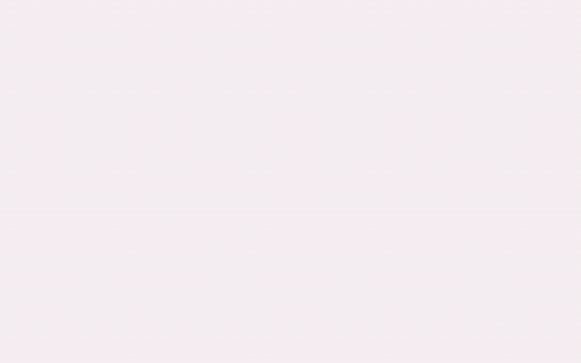

# FRIVOLO — artisan gelato

Toko online fiktif untuk gelato dan sorbetto artisan di Athena, ditujukan bagi pembeli rumahan, keluarga, dan pemesan untuk acara. Pengunjung bisa melihat produk, menghitung porsi pesta, meracik campuran sendiri, dan mengisi keranjang. Ini rebuild orisinal yang terinspirasi tampilan dan perilaku sebuah situs e-commerce referensi. Brand, produk, konsep, palet, teks, logo, gambar, dan kode dibuat baru. Bahasa situs: Yunani.

## Halaman (54)

| File | Isi |
|---|---|
| `index.html` | Beranda: hero gelato/sorbetto, pencari porsi, produk, manfaat, carousel, ulasan, FAQ |
| `products.html` | Semua produk dengan filter, urutan, dan tombol muat lagi |
| `category/*.html` (8) | gelato, sorbetto, toppings, biscotti, ergaleia, laboratorio, tourtes, xylakia |
| `product/*.html` (30) | Detail produk: animasi komposisi, pilihan kemasan, tab, bahan, accordion, cara saji, produk terkait |
| `why.html` | Cerita dan kelebihan gelato |
| `custom.html` | Wizard 5 langkah untuk meracik campuran |
| `calculator.html` | Kalkulator jumlah gelato per rombongan |
| `company.html` | Tentang brand, video, filosofi |
| `faq.html` | Pertanyaan umum per topik |
| `contact.html` | Peta ilustrasi, kontak, formulir |
| `delivery.html`, `returns.html`, `payments.html`, `privacy.html`, `cookies.html` | Halaman kebijakan |
| `account.html`, `cart.html`, `404.html` | Login (demo), keranjang + bar kupon, halaman tidak ditemukan |

## Fitur dan interaksi

- Intro beranda (satu kali per sesi atau saat reload) dan transisi antarhalaman.
- Hero yang tertahan dan mengecil saat scroll; toggle gelato/sorbetto mengganti foto, warna, dan tautan.
- Tepi section melengkung di canvas, pita teks berjalan, coretan tangan yang tergambar, bahan melayang, judul muncul per kata.
- Halaman produk: wadah berubah menjadi es stik berisi komposisi bahan; bar beli menempel di bawah.
- Mega menu, pencarian langsung, menu overlay, keranjang samping (tersimpan di `localStorage`), accordion, tab, carousel drag, slider ulasan, filter produk.
- Cursor kustom dan smooth scroll di desktop. Responsif, dan mengikuti `prefers-reduced-motion`.
- Tanpa sound.

## Teknologi

HTML, CSS, dan JavaScript native tanpa dependensi dan tanpa build. Font: Roboto Flex (disimpan lokal) sebagai pengganti font berlisensi pada referensi. Wordmark dibuat dari outline Unbounded.

## Cara menjalankan

Buka `index.html` di browser modern. Tidak perlu server.

## Struktur folder

```
├── index.html, products.html, why.html, custom.html, calculator.html,
│   company.html, faq.html, contact.html, delivery.html, returns.html,
│   payments.html, privacy.html, cookies.html, account.html, cart.html, 404.html
├── category/        8 halaman kategori
├── product/         30 halaman produk
├── assets/
│   ├── fonts/       Roboto Flex (Yunani, Latin)
│   ├── img/         gambar .webp + favicon.svg
│   └── video/       lab.mp4 + lab-poster.webp
├── css/style.css
├── js/main.js       interaksi
├── js/products.js   daftar produk untuk pencarian dan keranjang
├── docs/preview/    homepage.gif, hero.png
└── README.md
```

## Cara mengedit

- **Teks:** langsung di file `.html`. Header, menu, dan footer ada di tiap halaman, jadi ubah dengan cari-ganti di semua file.
- **Warna:** variabel di `:root` pada `css/style.css`. Warna canvas ada di atribut `data-color` pada HTML; warna latar yang berubah saat scroll ada di `js/main.js` (cari `mix(`).
- **Harga dan produk:** ubah di halaman produk, kartu di halaman daftar, dan `js/products.js`.
- **Gambar:** timpa file di `assets/img/` dengan nama yang sama. Packshot memakai latar putih karena ditampilkan dengan `mix-blend-mode: multiply`.

## Yang perlu diganti sebelum dipakai

Nama brand, alamat, telepon, email `ciao@frivolo.example`, jam buka, harga, nilai gizi dan alergen, ulasan (semuanya karangan), rating 4,9/312, kode kupon, teks kebijakan, peta, dan tautan media sosial. Formulir, login, dan checkout hanya demo. Copy Yunani sebaiknya diperiksa penutur asli.

## Kredit dan lisensi

- Gambar: dibuat AI (Nano Banana via Google Flow). Orang di foto fiktif.
- Video: Mixkit (Mixkit License).
- Font: Roboto Flex dan Unbounded, Google Fonts (SIL OFL 1.1).

## Keterbatasan

- Bentuk huruf tidak identik dengan referensi; lebar judul didekati lewat sumbu `wdth`.
- Hero memakai foto potongan dengan gerakan halus, bukan video transparan.
- Smooth scroll, tirai transisi, dan animasi scroll ditulis sendiri; kurva waktunya mendekati, tidak persis.
- Peta berupa ilustrasi SVG.
- Menu mobile memakai overlay yang sama dengan desktop.
